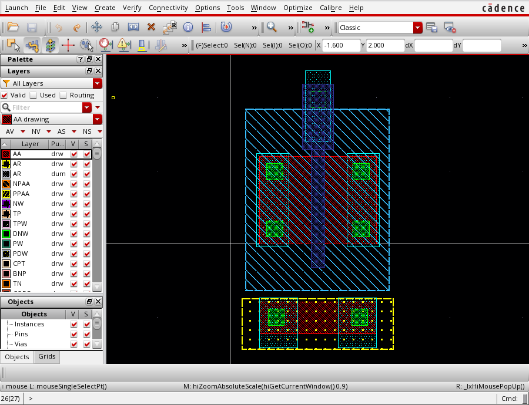

# NMOS 收敛到 DRC 只剩密度噪声、LVS CORRECT

2026-10-17。接上一轮（`SKILL-FIXES-AND-LVS.md`）。本轮把 **DRC 从 13 降到 7**，
其中 **7 个全是无法在单管上消除的**，并且 **LVS 通过**。



---

## 一、最终数字

| 项 | 结果 |
|---|---|
| 单元 | `DSH_NMOS/dsh_nmos9` |
| 形状 | 22（18 rect + 4 label） |
| bbox | `((0.17 -1.44) (2.23 2.37))` = 2.06 × 3.81 µm |
| 工艺 | `smic18ee`（SMIC 0.18） |
| **DRC** | **7 违规 / 393 检查**，其中 **0 个是几何问题** |
| **LVS** | **CORRECT**：Ports 4/4, Nets 4/4, Instances 1/1 `MN(<model>)` |

DRC 剩余 7 个的构成：

| 检查 | 数量 | 为什么消不掉 |
|---|---|---|
| `PD.GTa` / `PD.GPa` / `PD.CGb` | 3 | 密度规则：GT 最小 <rv>、GP 最小 <rv>、CG 最大 <rv> |
| `PD.M1` / `PD.M2` / `PD.M3` | 3 | 金属最小密度 <rv> |
| `MIM_8a` | 1 | deck 里该规则的描述为空，含义未查清 |

**6 条密度规则**是**全芯片/大区块**层面的约束：一个 2.06 × 3.81 µm 的孤岛管子，
无论怎么画都填不满 <rv> 的金属密度。它们只有放进有周边填充的版图里才有意义。

**所以：这块版图所有可修的 DRC 几何违规已经清零。**

---

## 二、收敛曲线

| 版本 | 违规 | 关键动作 |
|---|---|---|
| `dsh_nmos` | 22 | 起点（手工坐标） |
| `dsh_nmos2` | 24 | 参数化镜像对称 |
| `dsh_nmos4` | 35 | 放大 AA —— **恶化** |
| `dsh_nmos5` | 36 | 手算规则 —— **更糟** |
| `dsh_nmos6` | 18 | 改用约束求解器 |
| `dsh_nmos7` | 16 | + 数值解 `M1_2` |
| `dsh_nmos8` | 13 | + `GP_6` / SP 规则 |
| **`dsh_nmos9`** | **7** | + tap 结构（`solve-tap.py`） |

`24 → 35` 那一段是全过程的转折：**改大器件反而更差**，因为移动一条边会改变
哪条规则生效。从那以后不再调参，改求解。

---

## 三、tap 结构：6 个违规的真正原因

上一轮剩下的 6 个真实违规全在 tap（衬底接触）上。原因是**我把 tap 当附属品随手放的**。

`solve-tap.py` 把它们解成一组互相牵制的方程：

| 规则 | 要求 | 牵制关系 |
|---|---|---|
| `SP_16` | SP 顶边距栅极 0.35 | → **定死 SP 顶边** |
| `SP_1` | SP 宽 ≥ 0.44 | → SP 高度 |
| `SP_8` | SP 覆盖 tap ≥ 0.23 | → **反向迫使 tap 加高** |
| `SP_10&11` | SP 超出 tap ≥ 0.02 | → tap 顶边 |
| `CT_6a` | AA 包住接触孔 0.10 | → tap 高度 ≥ 0.22+0.20 |
| `CT_8` | SP 包住接触孔 0.12 | → 接触孔内缩 |
| `SN_4` | SN 到 P+ 拾取区 0.10 | → tap 下移 |
| `SN_7_17` | SN 包住**栅极末端** 0.32 | → SN 外扩 `GP_EXT+SN_GATE = 0.64` |
| `M1_6` | 金属面积 ≥ 0.20 µm² | → tap 金属加大 |

第一次求解时 SP 只有 `SP_MIN_W = 0.44`，扣掉两端 0.23 的覆盖后 tap 高度变成
**-0.02** —— 负数。这个矛盾说明 **tap 逼着 SP 必须比最小值更高**：
`SP 高 ≥ 0.23（下方覆盖）+ tap 高 + 0.02（上方超出）`。求解器算出 SP 要 0.69。

---

## 四、LVS 那个"看不见的断点"

LVS 第三次跑仍然 `INCORRECT`，报告是 `Nets 5 vs 4`，提取出 **`M0 S 5 D B`** ——
**栅极在内部节点 5 上**。

查了两轮才找到根因：**`GP_4` 要求场氧上两个 GP 相距 <rv>，所以我把栅极画成了
两个分离的多边形（指 + pad），而分离意味着栅极是两个网络。**

真实版图里栅极是**一个连续多边形**：`GP_4` 管的是"两个独立形状之间"的距离，
不是"同一个形状内部"的距离。改成 pad 与指**重叠**（pad 从 `y=1.30` 开始，
指到 `1.52`，重叠 0.22）后，两者并成一个连通形状，LVS 立刻通过。

**这个错误的教训**：DRC 全过 ≠ 电路对。DRC 只看几何间距，看不出电学连通性。
`GP_4` 我满足了，代价是把栅极劈成两半——只有 LVS 能发现。

顺带第二个同类问题：栅极 label 一开始放在 `y=1.90`，后来 pad 移到 `1.77–2.19`，
label 落在了接触孔上而不是 M1 金属上，端口绑不到网络。**label 必须落在对应网络
的金属内**，不是"画在附近就行"。

---

## 五、这一轮新增的工具与脚本

| 文件 | 作用 |
|---|---|
| `.validate/solve-tap.py` | tap 结构的约束求解，先自检再输出坐标 |
| `scratch/drc/draw-nmos9.il` | 最终几何（每个坐标注释了规则来源） |
| `scratch/drc/drc9.sh` | GDS 导出 + DRC |
| `scratch/drc/lvs9.sh` | GDS 导出 + LVS |
| `scratch/guest/wake_and_shot.sh` | DPMS 唤醒 + xwd 截图 |

### DPMS 又一次咬人

`xset s off; xset -dpms` 在脚本里执行了，`xwd` 仍然产出 **354 B / 2 色**的空白图。
真因：**关闭 DPMS 不会点亮已经关掉的屏**。必须先注入一次输入事件（`x11_drive.py
focus`）把输出唤醒，再截图。同样的 `xwd` 命令随后产出 88.7 KB 的真实图像。

这条已经在 `AGENTS.md` 里写了"每次操作前重做"，但**"重做"不只是重设 xset，
还要有一次真实输入事件**——这一点本轮才补上。

---

## 六、诚实清单

**已达成**
- 单管 NMOS，真工艺 `smic18ee`，几何 DRC 零违规（除密度/空规则）
- LVS CORRECT，器件识别为 `<model>`，L=0.18 µm，W=1.2 µm
- 对称性由 `MIR()` 构造保证，非手算

**未达成 / 未做**
- **没有 guard ring**。34 项 `GR_*` / `SLOT_*` 因此 `NOT EXECUTED`——它们因为前提
  不存在而被跳过，不是通过
- **没有阱**（NW/PW 一个都没画）。`<model>` 的 LVS 定义里 `pwell(B)` 存在，但几何上
  没有 PW 层。DRC deck 不检查这个（它 0 条 `DEVICE` 语句），所以没报错，
  **但这块版图在真实流片里会因为缺阱而失效**
- 密度规则无法在单管上满足
- 未跑 PEX / 寄生提取
- 未做多指 / 共质心匹配
- `MIM_8a` 的含义未查清

**最重要的一条**：**DRC 7 个不等于 DRC 干净。** 缺阱这件事 DRC 没报，因为我跑的
deck 是纯几何检查、不含器件识别。真实的流片检查会先要求阱层存在。

---

## 七、复现

```bash
python .validate/solve-nmos.py      # 器件几何（先自检）
python .validate/solve-tap.py       # tap 几何（先自检）
virtuoso_eval file=scratch/drc/draw-nmos9.il
bash scratch/drc/drc9.sh            # DRC -> 7
bash scratch/drc/lvs9.sh            # LVS -> CORRECT
```
