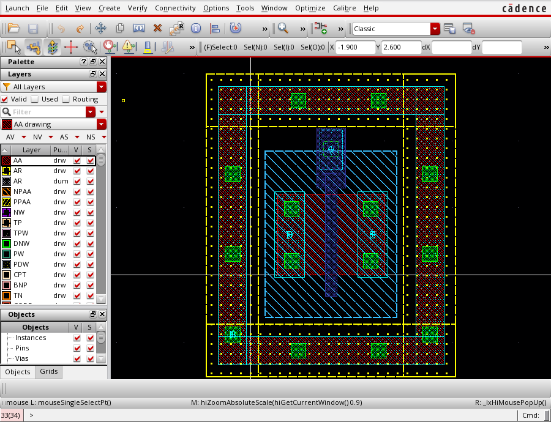

# dsh-plugin-virtuoso-layout

**An AI agent that drives Cadence Virtuoso to draw layout — packaged as a DeepSeek Harness plugin.**

12 host-side tools, zero runtime dependencies, driving **Virtuoso 6.1.7-64b** inside a
RHEL 6.5 VMware guest. Verified end to end on a real SMIC 0.18 µm process: the layout it
produced passes Calibre **DRC** with zero geometry violations and passes **LVS** as a
recognised `<model>` device.



---

## What this actually is

Not a script that clicks menus. Commands are **SKILL expressions evaluated inside the
running Virtuoso CIW**:

```
host (this plugin, Node.js)
  │  SSH / SCP
  ▼
guest (RHEL 6.5)
  │  virtoso-bridge daemon on :65452  ◄── SSH tunnel to 127.0.0.1:65453
  ▼
ramic_bridge.il inside the CIW
  │  evalstring("(progn …)")
  ▼
Cadence database API  →  dbCreateRect / dbSave / cv~>shapes
```

Because it goes through the database API rather than the GUI, the agent can state facts
about the layout — *"18 rectangles, bbox ((0.2 −1.0) (2.2 1.68)), gate length 0.18 µm"* —
instead of opinions about a picture.

XTEST key/mouse injection exists, but only to unwedge a modal dialog. It is never the
primary channel.

---

## The 12 tools

| Tool | Purpose |
|---|---|
| `virtuoso_status` | four-layer readiness: VM → sshd → tunnel → **CIW answers `1+1`** |
| `virtuoso_vm` | VM + tunnel lifecycle; `up` is the one-call repair |
| `virtuoso_config` | persisted settings, applied on the next call |
| `virtuoso_recover` | repair the guest GUI, then prove it with a real eval |
| `virtuoso_windows` | SKILL window list + X11 window ids |
| `virtuoso_screenshot` | capture one Virtuoso window to a PNG the model can look at |
| `host_window` | enumerate / raise / capture **Windows host** windows (the VMware console) |
| `virtuoso_eval` | arbitrary SKILL over stdin |
| `virtuoso_run` | a long guest command as a background job |
| `virtuoso_drc` | parse Calibre DRC output into structured JSON |
| `workspace_create` | register a workspace |
| `context_usage` | this session's token budget (read-only) |

Full parameter/output schemas: [`TOOLS.md`](TOOLS.md) — **generated from the live tool
definitions**, so it cannot drift from the code.

---

## The write gate

`lib/guard.js` installs a single global tool guard that denies mutating
`virtuoso_eval` / `virtuoso_run` calls unless they carry a stateless, sha256-derived
`confirm` token.

The contract was read out of the harness, and it shaped the whole design: a guard is
**synchronous** (it cannot wait for a human), it runs **after** the pre-execute
waterfall, it **can only deny** — it can never force a call through. So the design is:

- **Read-only calls are never gated.** `dbOpenCellViewByType(… "r")`, `cv~>shapes`,
  `sleep; echo` pass untouched — otherwise the gate trains you to paste tokens without
  looking.
- **Fail-closed.** If the sandbox policy cannot be read, the guard denies.
- **`confirm: true` is deliberately rejected.** That is a rubber stamp, not consent.
- **`danger-full-access` abstains**, because the user already granted full write
  authority — and `virtuoso_status` reports `enforcedNow` so the gate is observable.

Verified live in four cases: deny → token → allow, wrong token, read-only exempt, and
abstain under full access.

---

## Verified results

**For the illustrated version — the screenshots, and the full list of what is *still
unverified* — see [`RESULTS-SHOWCASE.md`](RESULTS-SHOWCASE.md).**

The `DSH_NMOS/dsh_nmos15` cell, on the real `smic18ee` SMIC 0.18 µm technology:

| | Result |
|---|---|
| **DRC** | 393 checks, **6 violations — all density rules**, zero geometry violations |
| **LVS** | **CORRECT** — `N=4 EP=4`, `M0 S G D B <model> L=0.18um W=1.2um` |
| Guard ring | four-sided P+ frame, closed loop proven by rasterising and counting holes |
| Iterations | 22 → 24 → 35 → 36 → 18 → 16 → 13 → 7 → **6** |

The 6 remaining are density rules (`PD.*`, `MIM_8a`): an isolated 3.7 × 4.5 µm device
cannot satisfy a `<rv>` metal-density target. Density compliance in a full chip is
**unverified**. These remain six **unmet** checks — not an exemption — and nothing here
is claimed to be DRC-clean or ready for tape-out.

**Not achieved, and documented as such:**

- **PEX / parasitic extraction.** The xRC rules are complete, but the shipped deck was
  written for Calibre xRC v2009.3 and the installed v2015.2 rejects it with Tcl parse
  errors. See [`PEX-STATUS.md`](PEX-STATUS.md). A control experiment with the unmodified
  deck rules out editor error.
- Multi-finger / common-centroid matching, place & route, clock tree, power grid.

---

## Documentation map

This project is as much a record of what went wrong as of what works. The failures are
the interesting part.

| Document | Contents |
|---|---|
| [`RESULTS-SHOWCASE.md`](RESULTS-SHOWCASE.md) | **start here for the outcome**: what was achieved, the screenshots, and what is still unverified |
| [`HISTORY.md`](HISTORY.md) | timeline, bug ledger, and the judgements that were **retracted** |
| [`AGENTS.md`](AGENTS.md) | project memory: paths, environment facts, troubleshooting order |
| [`LAYOUT-AUDIT.md`](LAYOUT-AUDIT.md) | hand-written geometry audit → discovering DRC is the authority |
| [`DRC-RESULTS.md`](DRC-RESULTS.md) | first real Calibre run: 393 checks, 22 violations |
| [`SKILL-FIXES-AND-LVS.md`](SKILL-FIXES-AND-LVS.md) | three SKILL method errors, first LVS pass |
| [`NMOS-FINAL.md`](NMOS-FINAL.md) | converging the device to density-only violations |
| [`WELLS.md`](WELLS.md) | well experiments: P-well is *derived*, N-well needs a pickup |
| [`RING-AND-CONNECTIVITY.md`](RING-AND-CONNECTIVITY.md) | measuring connectivity: 8 islands, a ring fixes 1 of 3 |
| [`RING-CLOSED.md`](RING-CLOSED.md) | closing the ring; why only a screenshot revealed it was a solid bar |
| [`PEX-STATUS.md`](PEX-STATUS.md) | why parasitic extraction does not run here |

### Three findings worth the read

1. **A guard ring that was a solid bar.** Four rectangles overlapped in y and filled in.
   No DRC rule says *"a ring must have a hole"*, and connectivity analysis counted one
   component and passed it. **A screenshot showed it immediately.** The fix was to
   rasterise the shapes at 10 nm and count enclosed holes — a check the eye can make,
   now automated.

2. **Prefix arithmetic is unavailable in Virtuoso 6.1.7.** `(- x d)` fails with a load
   error that reports the *end* of the wrapper, pointing nowhere near the fault. Infix
   (`x - d`) works. Six diagnostic rounds were spent on this.

3. **`procedurep` cannot probe built-in functions here.** It returns `nil` for `geOpen`,
   which demonstrably works, and `errset` collapses *"no such function"* and *"refused"*
   into the same `nil`. Every conclusion drawn from those probes had to be re-derived.

---

## Requirements

- **Cadence Virtuoso** with a licensed install (this was developed against 6.1.7-64b)
- A Linux guest reachable over passwordless SSH, in VMware or similar
- A technology library to bind to
- **Calibre** for DRC/LVS (optional; the plugin can drive Virtuoso without it)
- Node.js (the plugin uses **only Node builtins** — no `npm install`)
- DeepSeek Harness

Without Virtuoso and a PDK this plugin has nothing to drive. It is published because the
**technique** — turning an opaque EDA tool into a programmable, verifiable, documented
interface — transfers to any tool with a scripting layer.

---

## Installing the plugin

```bash
# from the DSH checkout
node tools/virtuoso.mjs config-set vmrun="C:\path\to\vmrun.exe"
node tools/virtuoso.mjs config-set vmx="D:\path\to\guest.vmx"
node tools/virtuoso.mjs config-set guestIp=192.168.1.50
node tools/virtuoso.mjs config-set sshUser=youruser
node tools/virtuoso.mjs health      # proves the CIW answers
```

Then copy `dsh-plugin-virtuoso-layout/` into your DSH profile's `node_modules/` and
restart DSH. `lib/*.js` changes require a restart (HMR only watches patch files).

## Validating without a VM

```bash
node .validate/plugin-test.mjs     # registers all 12 tools against a mock ctx
node .validate/guard-test.mjs      # the write gate: classification / policy / registration
node .validate/context-test.mjs    # token-meter contract, 50 checks
node .validate/job-test.mjs        # background-job payload, 8 checks
node .validate/hint-test.mjs       # error-message mapping
node .validate/paren-check.mjs f.il  # SKILL paren balance
```

---

## Credits and acknowledgements

### Tsinghua University

This project would not exist without the **RAMIC Bridge** SKILL layer, and that comes
from **Tsinghua University**.

**[virtuoso-bridge-lite](https://github.com/Arcadia-1/virtuoso-bridge-lite)** (MIT) is by
**Zhishuai Zhang, Xintian Li, Nan Sun and Lu Jie** — the work of **Professor Nan Sun's
group at Tsinghua University**, whose research spans analog and mixed-signal IC design
and the EDA automation around it. The `ramic_bridge.il` file that lets a socket evaluate
SKILL inside a live CIW — the single mechanism this whole plugin stands on — is theirs.

Sincere thanks to Tsinghua University and to that group for releasing it. **清华大学，谢谢。**

That project is *not* vendored here; it is a dependency. Install it from its own
repository.

### Mentor Graphics / Siemens EDA

Calibre, whose DRC and LVS decks made it possible to *check* the layout rather than
merely look at it. The verdicts quoted in the documents are Calibre's, not this
project's.

### Cadence

Virtuoso, and the SKILL language and database API the plugin drives.

### Note on third-party material

No foundry PDK, rule deck, or Calibre output containing rule text is included in this
repository. Foundry decks are confidential material and are distributed only by the
foundry to licensed customers.

What the documents here **do** contain: the decks' *rule identifiers* (`GP_11a`,
`SP_1`, `M1_6`) and the *reasoning* behind each geometry decision — which rule pinned
which edge, and what changing it broke. What they do **not** contain: the decks' own
wording, and any statement of a rule's limit. Where a limit would otherwise appear it
is written `X` (in the Python solver scripts) or `<rv>` (in prose and tables), and the
PDK's device model name is written `<model>`.

Two limits of that redaction, stated plainly rather than implied:

- With the values gone, `solve-*.py` is a **template**, marked as one at the top of each
  file: it records *which rule drives which edge* and **is not runnable until you fill
  the values in from your own deck**. That is the intent, not a defect.
- Numbers still appear as **our own** geometry and arithmetic. The redaction removes
  every place that names a rule *and* its limit; it does not — and cannot, without
  destroying the engineering record — remove every number that happens to coincide
  with one.

**This is therefore not an out-of-the-box reproduction package.** Running it needs a
licensed Virtuoso, a licensed Calibre, a PDK obtained from your foundry, and DRC/LVS
invocation scripts written against *your* installation. The `scratch/drc/*.sh` scripts
here are the temporary ones actually used, carrying local paths and deck names; at
least one of them was not kept. Reproducing the result means supplying those pieces
yourself — not obtaining private parameters from us.

Obtain the decks from your foundry.

---

## License

MIT — the full text is in [`LICENSE`](LICENSE), and the package manifest says the same
thing in [`dsh-plugin-virtuoso-layout/package.json`](dsh-plugin-virtuoso-layout/package.json).

Third-party notices that must not be folded into the MIT text — the
`virtuoso-bridge-lite` attribution, and what foundry material is deliberately absent —
are in [`THIRD-PARTY.md`](THIRD-PARTY.md). That split is not fussiness: GitHub identifies
a licence by template-matching the file, so appending paragraphs to `LICENSE` makes the
repository report `NOASSERTION` instead of `MIT`.
