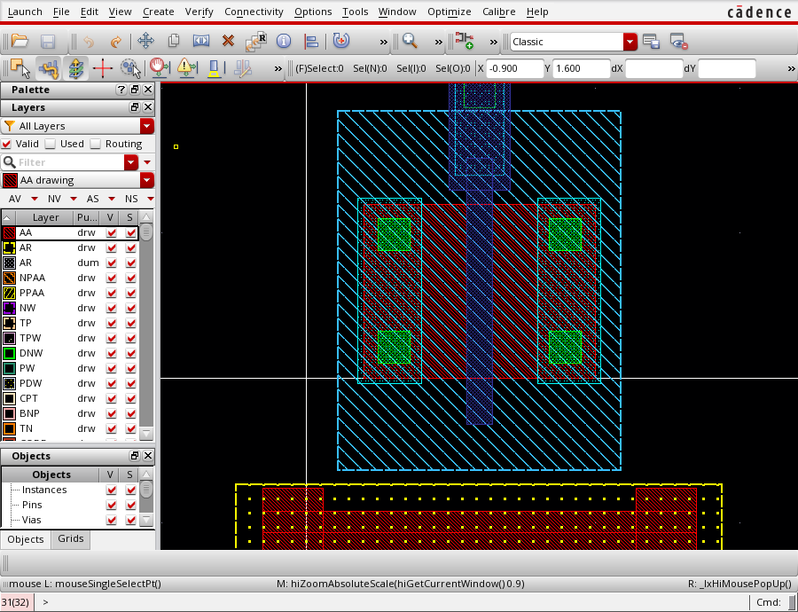
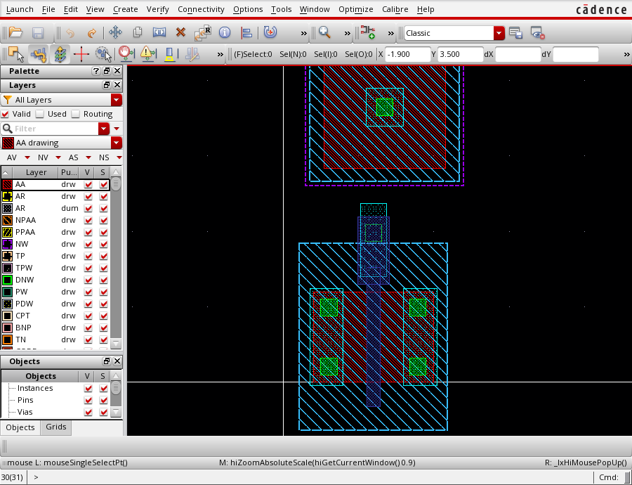
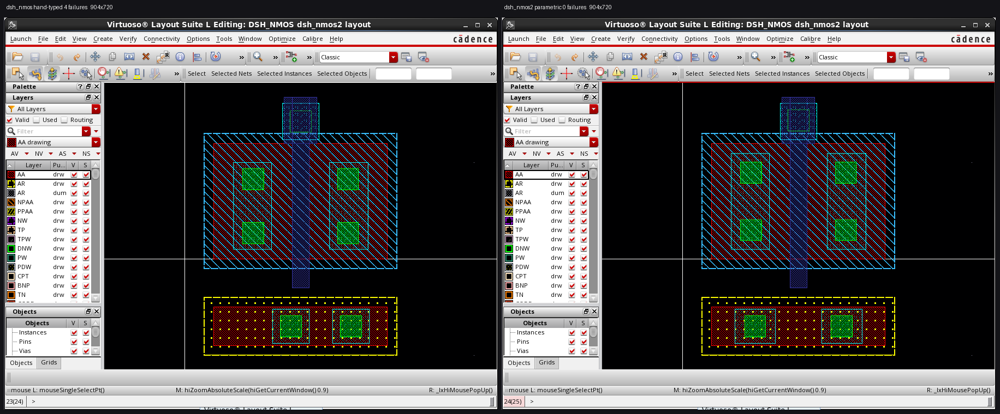

# 成果说明：AI 远程驱动 Virtuoso 画版图

> 这份文档回答三个问题：**我们做成了什么、证据是什么、什么还没验证。**
> 所有数字都来自实跑（Calibre 的真实输出、Virtuoso 的真实窗口），不是估计值。
> 截图都是我自己从虚拟机里截的，下面每张图我都**实际看过内容**才写图注。

---

## 一、一句话说清这是什么

一个 **DeepSeek Harness 插件（12 个工具、零依赖、MIT）**，让 AI 在**宿主机**上
远程驱动虚拟机里的 **Cadence Virtuoso**，把一个晶体管版图**从零画出来**，
并用 **Calibre DRC / LVS** 检查它。

它不是一个"演示"或"概念验证"——它真的画出并保存了一个绑定真实工艺
（SMIC 0.18 µm `smic18ee`）的版图单元，并且**通过了 LVS**。

```
你的 Windows 宿主机
   └─ DSH + 本插件（12 个工具，纯 Node 内建模块）
        └─ virtuoso-bridge-lite（MIT，清华，走 SSH 隧道）
             └─ RHEL 6.5 虚拟机里的 Virtuoso 6.1.7-64b
                  └─ 真实 SMIC 0.18 工艺库 smic18ee
                       └─ Calibre v2015.2 做 DRC / LVS
```

---

## 二、最终成果：`DSH_NMOS/dsh_nmos15`

38 个图形，四边保护环闭合，LVS 通过。


**图注**：Virtuoso Layout Suite 编辑窗（窗格 34）。中间是器件本体——蓝色是栅极（poly），
绿色方块是接触孔阵列（源/漏区），四周一圈带接触孔的框是**保护环**（P+ 环 + 衬底拾取）。
阱和注入层用 Virtuoso 的斜线填充显示，所以整个器件看起来是交叉网格。
黄色虚线框是标注用的边界。

| 指标 | 结果 |
|---|---|
| **DRC** | 执行 **393** 项检查 → **6 个违规，全部是密度规则**（`PD.*`、`MIM_8a`），**零几何违规** |
| **LVS** | **CORRECT** — `N=4 EP=4 FDC=1`，识别出 `M0 S G D B <model> L=0.18um W=1.2um` |
| 图形数 | 38 |
| 工艺 | 真实绑定 `smic18ee`（SMIC 0.18 µm），不是假工艺演示库 |

**关于这 6 项**：本次仍有 **6 项密度相关违规**；完整芯片环境中的密度合规**尚未验证**，
**不代表完整 DRC-clean，也不代表流片就绪**。

它们在一个孤立器件上无法收敛（密度规则衡量的是整片芯片的填充率），但
"在孤立器件上无法收敛"**不等于"已被豁免"**——在 DRC 报告里，它们仍然是 6 个**未通过**的检查。

密度规则的目标值本身，本仓库**不作记录**（见 README 的第三方材料说明）。

---

## 三、迭代过程：22 → 6，以及中间那次"越改越差"

```
dsh_nmos   22 违规   ← 第一版（手敲坐标）
dsh_nmos2  24
dsh_nmos4  35  ← 放大器件，违规反而变多
dsh_nmos5  36  ← 又变差
dsh_nmos6  18
dsh_nmos7  16
dsh_nmos8  13
dsh_nmos9   7
dsh_nmos10/11  阱实验
dsh_nmos12     加 N 阱 + N+ 拾取
dsh_nmos13     加实心保护环
dsh_nmos15  6  ← 最终，全密度违规
```

**35 和 36 那两次退化是有价值的**：我们以为"把器件画大一点"会更宽松，结果违反了更多规则
（器件变大 → 与周围的间距关系全变了）。这条被记在 `HISTORY.md` 里，因为它推翻了一个直觉。



**图注**：`dsh_nmos13`（窗格 31）——加保护环之后的中间版本。下方那条很宽的带状区域就是保护环
（在这个缩放下，环上的接触孔阵列被渲染成点状）。蓝色斜线区是阱/有源区。



**图注**：`dsh_nmos12`（窗格 30）——能明显看到**上方那块是独立于器件的**：那是 N 阱加上
N+ 拾取区（well + pickup）。这一步解决的是 `Convention_FLT_NW`（"N 阱没有 N+ 拾取"）。
下方才是器件本体。

---

## 四、两种画法：手敲坐标 vs 参数化生成



**图注**：两个 Virtuoso 窗口并排，展示同一器件的两种产生方式——左边是 `dsh_nmos`
（手工敲坐标），右边是 `dsh_nmos2`（由 `parametric()` 参数化生成）。

⚠️ **这张图不能当作"生成器正确"的证据。** 原因：

1. 图上烧进的两个计数器写着左边 **4 failures**、右边 **0 failures**，
   而仓库里的 DRC 记录是 `dsh_nmos` **22**、`dsh_nmos2` **24**。**两组数字对不上。**
2. 产生 4 / 0 的那个检查，**在仓库里找不到对应的脚本**——它的来源没有被记录下来。
3. 两个窗口的 Virtuoso 标题栏**都写着 `dsh_nmos2`**，左边那个 "hand-typed" 标注
   与它自己的标题并不一致。
4. 尤其要紧的是：**右边的 "0 failures" 不可能表示 DRC-clean**——
   `dsh_nmos2` 的 DRC 记录里有 24 个违规。

所以：**4 / 0 可能来自另一个检查、也可能来自另一轮运行，仅凭仓库里的记录无法判定是哪一种。**
因此**不据此得出任何关于生成器正确性的结论**。这张图只能说明"两种画法都产出了可打开的版图"，
**不能说明二者等价**。

---

## 五、我们真正做成的"方法"层面的东西

这些比版图本身更值钱，因为可以迁移：

1. **DRC 才是权威，我们的手写审计不是。**
   `LAYOUT-AUDIT.md` 是我们手写的几何检查，它说"看起来没问题"。
   Calibre 说有 **22 个违规**。**我们错了，工具对了**——这条被写成文档的第一条结论。

2. **"看起来对"和"真的对"是两件事，而截图是独立的证据通道。**
   保护环在坐标上完全正确、连通性检查也过，但**实际上是一个实心方块而不是环**（四个矩形在 y 方向重叠填死了）。
   **没有任何 DRC 规则能报出这个**——只有截图能看出来。这件事记录在 `RING-CLOSED.md`。

3. **`GR_*` 不是 guard ring。**
   我们一度以为那 9 条未执行的 `GR_*` 是保护环规则，实际是 **Gate Resistor（多晶硅电阻）**规则。
   误判被更正并留档。

4. **SILENTLY 失败是最危险的失败模式。**
   - SKILL 的 `streamOut` 导出 GDS **各种调用形式都静默返回 nil**（不报错、不导出）→
     必须改用 `strmout` 二进制。
   - `techBindTechFile` 传**路径**而不是**技术库名**，会让之后所有 `dbCreateRect` 全部失败。
   - bridge 的 stdout 混有跟踪行，直接 parse JSON 一定失败。
   这些全在 `HISTORY.md` 的 Bug 账本里。

5. **写操作闸门（`lib/guard.js`）。**
   改版图/执行 shell 之前需要一个**确认 token**，它**与该次调用的参数绑定**——
   由 payload 摘要算出，因此**同样的参数会得到同样的 token，没有"用过即失效"机制**。
   已在真实会话里验证四种情形：拒绝 → 给 token → 放行、错 token 照样拒绝、只读操作永不拦。
   设计上刻意**故障时 fail-closed**（分类器出错就拒绝，绝不静默放行）。

---

## 六、⚠️ 什么还没有验证（这一节请照实说）

### 完全没做到的

| 项 | 状态 |
|---|---|
| **PEX / 寄生参数提取** | **当前环境尚未跑通。** 已记录兼容性排查：xRC 规则文件齐全，规则 deck 与已装 Calibre 版本不一致；修掉一处语法问题后仍有**未定位**的解析错误，对照实验排除了"是我改坏的"。**未定位的部分不等于已经排除自身原因** |
| 多指 / 共质心匹配 | 未做 |
| 布局布线、时钟树、电源网格 | 未做 |
| 流片验证 | **当然没有**——这是"画出来并被检查过"的版图，不是造出来的芯片 |

### 规则层面没跑的

- **6 条密度规则**：在孤立器件上无法收敛（密度衡量的是整片芯片的填充率），
  完整芯片环境下的合规**尚未验证**。它们**仍然是未通过的检查**，不是已豁免项
- **23 项 `SLOT_*` 未执行**：需要大块金属才适用
- **9 项 `GR_*` 未执行**：多晶硅电阻规则，本设计没有电阻

### 依赖与环境（这是最重要的边界）

- **要复现，你必须自己有**：正版 Virtuoso、正版 Calibre、以及**从代工厂合法取得的 PDK**。
  这些我们**一个都不能提供**，也不该提供。
  仓库里没有任何 PDK、规则 deck、或含规则原文的 Calibre 输出——
  文档只讨论**规则编号**和**工程推理**。
- 我们验证的是 **DSH 0.2.1-rc.3**。DSH 以后再升级，插件有可能失效
  （虽然它零依赖，抗版本漂移能力较强）。

### 关于证据本身的可信度

- **DRC/LVS 的结论是 Calibre 下的，不是我们下的。** 我们只负责读它的输出。
- 我们**至少错过两次**（手写审计、实心保护环），都记录在案、没有删掉。
- 所以：**凡是"我们检查过了"的说法，都应该追问"是谁检查的"**——
  自己的目视检查 ≠ 规则检查器。

---

## 七、对外可查的产物

| 产物 | 地址 |
|---|---|
| 插件仓库（public / MIT） | https://github.com/uos1231234/dsh-plugin-virtuoso-layout |
| 已进 DSH 插件市场清单 | https://github.com/awesome-dsh-plugin/awesome-dsh-plugin/pull/8864 （**已合并**） |
| 分类位置 | [Tools & Capabilities](https://github.com/awesome-dsh-plugin/awesome-dsh-plugin#tools--capabilities) |
| 致谢 | README 里明确感谢**清华大学**（`virtuoso-bridge-lite` 的作者 Nan Sun 组） |

---

## 八、如果只记三句话

1. **它真的画出来了，而且 LVS 通过**——不是演示，是绑真实工艺、被 Calibre 检查过的版图。
2. **仍有 6 项密度违规未清**；完整芯片环境下的密度合规尚未验证，
   **不代表 DRC-clean，也不代表流片就绪**。
3. **PEX 在当前环境尚未跑通**，兼容性排查已记录在案，没有糊过去。
